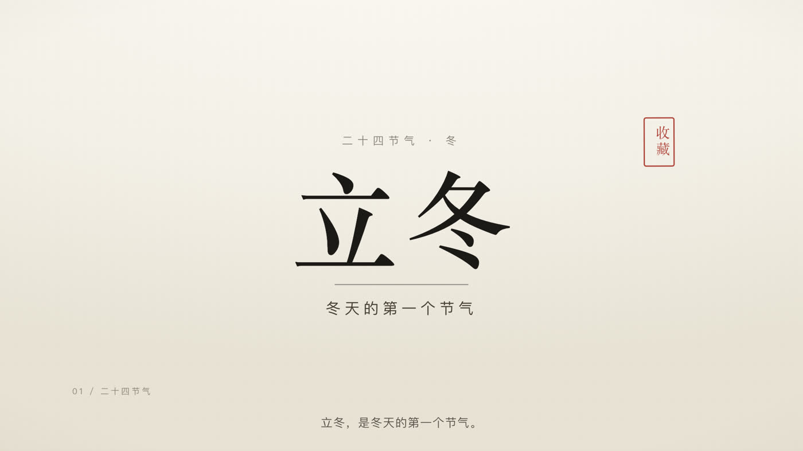

# vibe-k12 · K12 知识动画生产线

把「一份剧本」变成「一条逐帧渲染的知识动画」。画面不是视频模型生成的，而是
**Agent 写代码 → 无头浏览器按时间码渲染 → ffmpeg 合成**，所以字幕不会错字、
公式排版精准、改一个字重渲一段就行。



示例成片：立冬（10 屏 / 78 秒 / 1080P30），分镜稿见 [docs/storyboard.md](docs/storyboard.md)。

## 安装

依赖：Python 3.10+、ffmpeg、Playwright 的 Chromium。

```bash
python3 -m venv .venv
.venv/bin/pip install -r requirements.txt
.venv/bin/playwright install chromium   # 已有浏览器可跳过
```

`render.py` 会自动在 `~/Library/Caches/ms-playwright` 下找 Chromium，
也可用环境变量 `VK12_CHROMIUM` 指定路径。

## 目录

```
vibe-k12/
├── content/            # ★ 只改这里：每期一个 JSON
│   └── lidong.json
├── engine/
│   ├── build.py        # 主流程（配音→时间轴→渲染→混音→编码）
│   ├── tts_edge.py     # edge-tts 配音（在线合成，少年音）
│   ├── tts_kokoro.py   # Kokoro 离线配音（断网兜底）
│   ├── bgm.py          # 程序化配乐（五声音阶，零版权）
│   ├── render.py       # Playwright 逐帧截图
│   └── snap.py         # 任意时间点截图，用来快速查版式
├── templates/
│   ├── player.html     # 播放器：把时间轴变成 DOM
│   ├── style.css       # 视觉系统：色板/字体/版式
│   └── scenes.js       # 场景模板库
├── out/<id>/           # 产物：mp4、mix.wav、frames、timeline.json、sheet.jpg
└── .venv               # 项目环境
```

## 跑一条片子

```bash
cd vibe-k12

# 整片
.venv/bin/python engine/build.py content/lidong.json

# 先渲 20 秒试片（改版式时用这个，别整片跑）
.venv/bin/python engine/build.py content/lidong.json --clip 20

# 只重渲画面（配音已生成过）
.venv/bin/python engine/build.py content/lidong.json --skip-tts

# 只看某几个时间点的版式
.venv/bin/python engine/snap.py out/lidong 12 30 46 63
```

产物在 `out/<id>/`：`<id>.mp4`、`mix.wav`、`frames/`、`timeline.json`、`sheet.jpg`（联系表）。

## 换一期内容 = 换一个 JSON

新建 `content/xxx.json`，结构固定，**不用碰代码**：

```json
{
  "meta":  { "id": "xxx", "title": "...", "fps": 30,
             "width": 1920, "height": 1080,
             "lead_in": 0.8, "tail": 2.4, "bgm_gain": 0.085 },
  "voice": { "engine": "edge", "name": "zh-CN-YunxiaNeural",
             "rate": "+6%", "pitch": "+12Hz" },
  "scenes": [
    { "template": "cover",
      "narration": "旁白文本",
      "pad": 1.6,
      "props": { "title": "...", "sub": "..." } }
  ]
}
```

- `narration`：这一屏的旁白。**场景时长 = 旁白时长 + pad**，自动算时间轴，不用手调。
- `pad`：旁白说完后多停留几秒，给画面呼吸。
- 不写 `narration` 时用 `dur` 指定固定秒数。
- 换配音引擎：`"engine": "kokoro"`，`name` 改成 `zf_xiaobei` 之类（见下）。

## 可用的场景模板

| template | 画面 | 主要 props |
|---|---|---|
| `cover` | 封面大标题 + 印章 | `kicker` `title` `sub` `seal` `corner` |
| `seasons` | 四个圆环并列，可高亮一个 | `items[{t,s}]` `active` |
| `statement` | 两行大字陈述 + 脚注 | `lines[]` `foot` |
| `bigchar` | 超大单字 + 拼音 + 释义 + 对照条目 | `char` `pinyin` `gloss` `pairs[{k,v}]` |
| `quote` | 竖排引文 + 出处 | `lines[]` `source` |
| `compare` | 左右两栏对比 | `left{title,items[]}` `right{...}` |
| `timeline` | 横轴四节点，可高亮 | `points[]` `active` `badge` `fact` |
| `ritual` | 左标题 + 右三步流程 | `title` `steps[{n,t}]` |
| `food` | 三张圆角卡片 | `title` `items[{e,n,d}]` `note` |
| `outro` | 结尾三行 + 落款印章 | `lines[]` `tag` |

要加新模板：在 `templates/scenes.js` 里加一个函数，返回 `{el, update(local,dur)}`，
并在 `style.css` 加样式。**update 必须是纯函数**——给定时间 t 画面状态唯一确定，
否则就不能任意跳帧、不能断点续渲。

## 配音

### 主力：edge-tts（本机生成，合成走微软在线接口）

| 角色 | 音色 | 参数 |
|---|---|---|
| 主讲少年 | `zh-CN-YunxiaNeural` | `--rate=+12% --pitch=+18Hz` |
| 女同学 | `zh-CN-XiaoyiNeural` | `--rate=+8% --pitch=+10Hz` |
| 成年女声 | `zh-CN-XiaoxiaoNeural` | 默认 |
| 低沉男声 | `zh-CN-YunjianNeural` | `--pitch=-8Hz` |

注意：免费端点**没有童声** `zh-CN-XiaoshuangNeural`（Azure 付费专属）。

### 兜底：Kokoro-82M（完全离线）

装在 `~/tts/kokoro/`（`kokoro-v1.0.onnx` 310MB + `voices-v1.0.bin` 27MB + 独立 venv），
中文必须先经 `misaki[zh]`（ZHG2P）注音——它的中文音色就是按这套音素训练的，
直接喂文本会报 `language "zh" is not supported by the espeak backend`。

中文音色 8 个：`zf_xiaobei` `zf_xiaoni` `zf_xiaoxiao` `zf_xiaoyi`
`zm_yunjian` `zm_yunxi` `zm_yunxia` `zm_yunyang`（都是成人声线）。

```bash
~/tts/kokoro/.venv/bin/python engine/tts_kokoro.py --list
~/tts/kokoro/.venv/bin/python engine/tts_kokoro.py --text "测试" --voice zf_xiaobei --out t.wav
```

实测（Intel Mac，CPU）：5.16 秒音频约 6 秒算完（含 3 秒模型加载），≈1 倍实时。
童声化：`ffmpeg -i in.wav -af "rubberband=pitch=1.12" out.wav`

## 已知约束

- **Intel Mac 无 GPU**：逐帧截图约 2.8 fps，1 分钟片 ≈ 9 分钟渲染；4 分钟片 ≈ 35 分钟。用 `--clip` 先试。
- Playwright 版本需与已缓存的 Chromium 匹配；`render.py` 会自动扫描 `~/Library/Caches/ms-playwright` 找可执行文件，也可用环境变量 `VK12_CHROMIUM` 指定。
- 字体依赖 macOS 自带：宋体 `Songti SC`、楷体 `Kaiti SC`、黑体 `PingFang SC`。换平台要改 `style.css` 的 `--serif/--sans/--kai`。
- 字幕安全区：底部 200px 留给旁白字幕，其他元素不要压进这个区。
